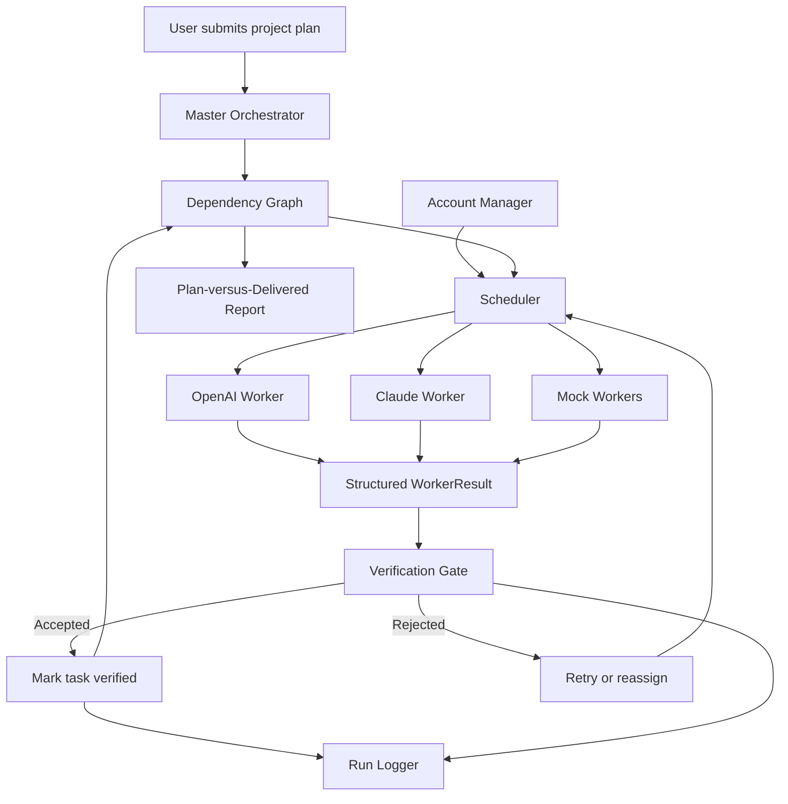

# Multi-Account, Multi-Agent Orchestrator

A Python prototype that coordinates multiple AI Workers through a central Master Orchestrator, with dependency-aware scheduling, isolated workspaces, failure handling, and output verification.

> **One project plan → Multiple Workers → Independent verification → Retry or reassignment → Final delivery report**

The central principle is simple: a Worker claiming that a task is complete is not enough. The Master should accept the deliverable only after it passes the Verification Gate.

## Table of Contents

- [Overview](#overview)
- [Features](#features)
- [Architecture](#architecture)
- [Project Structure](#project-structure)
- [Requirements](#requirements)
- [Setup](#setup)
- [Configuration](#configuration)
- [Running the Prototype](#running-the-prototype)
- [Testing](#testing)
- [Security and Guardrails](#security-and-guardrails)
- [Assignment Documentation](#assignment-documentation)
- [Current Limitations](#current-limitations)
- [Future Improvements](#future-improvements)

## Overview

This project explores how multiple AI Workers can collaborate on a larger engineering plan while a central orchestrator controls task execution and validates results.

The Master Orchestrator is responsible for coordination, scheduling, failure handling, and verification. Workers execute individual tasks and return results through a shared data contract.

The prototype supports mock Workers for repeatable testing and includes integrations for OpenAI and Anthropic Claude, subject to valid credentials, provider access, and quota availability.

## Features

- **Multi-Worker orchestration:** Coordinate multiple configured Workers through one Master.
- **Account management:** Load Worker definitions from configuration.
- **Dependency-aware scheduling:** Execute eligible tasks while respecting prerequisites.
- **Parallel execution:** Allow independent tasks to run concurrently.
- **Structured Worker results:** Normalize task outcomes through a shared `WorkerResult` contract.
- **Workspace restrictions:** Restrict supported file operations to designated Worker workspaces.
- **Failure handling:** Exercise Worker failure, quota exhaustion, retries, and reassignment scenarios.
- **Output verification:** Check artifacts and configured acceptance criteria before accepting work.
- **Run logging:** Record relevant execution events with sensitive-field redaction.
- **Plan-versus-delivered reporting:** Summarize verified outputs and unresolved work.
- **Interactive demo:** Use the Streamlit interface to explore normal and failure scenarios.

## Architecture



### Execution lifecycle

1. The user provides a project plan.
2. The Master decomposes the work into tasks and dependencies.
3. The Scheduler selects tasks whose prerequisites are verified.
4. An available Worker executes each assigned task.
5. The Worker returns a structured result and reports its output artifacts.
6. The Verification Gate checks the output against the configured criteria.
7. Accepted tasks are marked verified; rejected or failed tasks can be retried or reassigned.
8. Unresolved tasks and blocked dependencies are reported rather than silently treated as successful.
9. The system produces a final plan-versus-delivered report.

## Project Structure

```text
multi-account-orchestrator/
├── account/          # Account and Worker configuration management
├── config/           # Worker configuration examples
├── docs/             # Architecture, design note, and scenario answers
├── models/           # Shared schemas and data models
├── orchestrator/     # Master, scheduler, and dependency graph
├── security/         # Workspace, command, and logging guardrails
├── tests/            # Automated tests
├── ui/               # Streamlit interface
├── verification/     # Verification gate and reporting
├── workers/          # Mock and provider-specific Workers
├── .env.example      # Environment variable template
├── .gitignore
├── main.py           # Prototype entry point
├── requirements.txt  # Python dependencies
└── README.md
```

This tree describes the intended repository organization. Refer to the actual files in the repository for the current implementation.

## Requirements

- Python 3.10 or a compatible version supported by the project's dependencies.
- Git.
- `pip`.
- API credentials only if testing a live provider integration.
- Streamlit if running the interactive interface.

Check your Python version:

```bash
python --version
```

## Setup

### 1. Clone the repository

```bash
git clone https://github.com/sunny-shrivas/multi-account-multi-agent-orchestrator.git
cd multi-account-multi-agent-orchestrator
```

### 2. Create a virtual environment

macOS/Linux:

```bash
python3 -m venv .venv
source .venv/bin/activate
```

Windows PowerShell:

```powershell
python -m venv .venv
.venv\Scripts\Activate.ps1
```

### 3. Install dependencies

```bash
python -m pip install --upgrade pip
pip install -r requirements.txt
```

### 4. Configure environment variables

Create your local environment file:

```bash
cp .env.example .env
```

Open `.env` and add the credentials needed for the provider you intend to test.

Example:

```dotenv
OPENAI_API_KEY=
OPENAI_MODEL=gpt-4.1-mini
ANTHROPIC_API_KEY=
```

Keep credentials private. Never commit `.env` or paste API keys into source files, prompts, screenshots, or logs.

If you only want to test mock Workers, use the mock configuration and follow the corresponding local setup path without adding provider credentials.

## Configuration

Worker definitions are loaded from configuration files in `config/`.

Review the available configuration examples before running the prototype. Select a configuration that matches your intended execution mode:

- **Mock mode:** For repeatable local execution and failure testing.
- **Live-provider mode:** For testing configured OpenAI or Anthropic integrations with valid credentials and available quota.

Configuration filenames and supported fields should be confirmed against the actual files in `config/` before use.

## Running the Prototype

### Run the command-line entry point

From the repository root, with the virtual environment activated:

```bash
python main.py
```

Use the configuration and arguments expected by the current entry point. If the script requires additional options, inspect its help output or implementation before running it.

### Run the Streamlit interface

```bash
streamlit run ui/app.py
```

If Streamlit is not installed in the environment, install the project's declared dependencies first.

The interface includes mock execution scenarios for normal execution, Worker failure, quota exhaustion, and bad-output rejection.

**Note:** The live OpenAI and Claude execution paths are implemented, but live-provider execution was not demonstrated for this submission because API credits were unavailable. No live execution is claimed.

## Testing

Run the automated test suite from the repository root:

```bash
pytest -q
```

For verbose test output:

```bash
pytest -v
```

The test suite is intended to cover the core orchestration workflow and important failure cases, including:

- Successful task execution.
- Worker failure handling.
- Quota exhaustion.
- Rejection of bad Worker output.
- Retry and reassignment behavior.
- Dependency handling.
- Workspace restrictions.
- Sensitive-field log redaction.
- Worker result validation.

The actual passing count should be taken from the latest local test run. Passing tests demonstrate the tested behavior, not complete production readiness.

## Security and Guardrails

The prototype includes application-level security controls:

- Environment-based credential configuration.
- Workspace path restrictions.
- Checks for selected dangerous command patterns.
- Sensitive-field redaction in logs.
- Structured execution results and verification outcomes.

These controls have important limits. Pattern-based command checks are not a comprehensive sandbox, and workspace path restrictions alone do not isolate a compromised process from the operating system.

A production deployment would require stronger process or container isolation, least-privilege permissions, filesystem and network restrictions, managed secrets, robust tool authorization, and additional prompt-injection testing.

Provider integrations must also comply with each provider's applicable terms, rate limits, and account policies. Multiple subscriptions should not be assumed to be eligible for pooling or automated use without checking the relevant terms.

## Assignment Documentation

The `docs/` directory contains the supporting design documents for the take-home assignment.

| Document | Purpose |
|---|---|
| [Architecture](docs/architecture.md) | Components, architecture diagram, and execution lifecycle |
| [Design Note](docs/design-note.md) | Requirements, security, testing, limitations, and hardening roadmap |
| [Scenario Answers Q1–Q7](docs/scenario-answers.md) | Responses to the seven assignment scenarios |

## Current Limitations

This repository is a prototype, not a production-ready orchestration platform.

- Live-provider execution has not been demonstrated for this submission.
- Verification relies primarily on deterministic checks and does not prove semantic correctness for arbitrary deliverables.
- Workspace and command guards do not provide comprehensive operating-system sandboxing.
- Automated Git conflict resolution is a proposed extension.
- A complete human-approval workflow is not implemented.
- Performance with twenty live accounts has not been benchmarked.
- Provider compliance depends on the specific integration method and applicable provider policies.

These limitations are documented explicitly to distinguish demonstrated behavior from future design proposals.

## Future Improvements

Potential next steps include:

1. Stronger process isolation and least-privilege execution.
2. Persistent task state and recovery after interruption.
3. Quota-aware scheduling and bounded retry policies.
4. More comprehensive artifact verification and automated test execution.
5. Git-based integration with conflict detection and controlled merges.
6. Risk-based human approval for sensitive actions.
7. Better monitoring, execution metrics, and cost tracking.
8. Additional validation of provider terms and permitted authentication methods.

## Design Principle

The Master coordinates. Workers execute. The Verification Gate checks.

**A task is complete only when the required evidence supports completion.**
