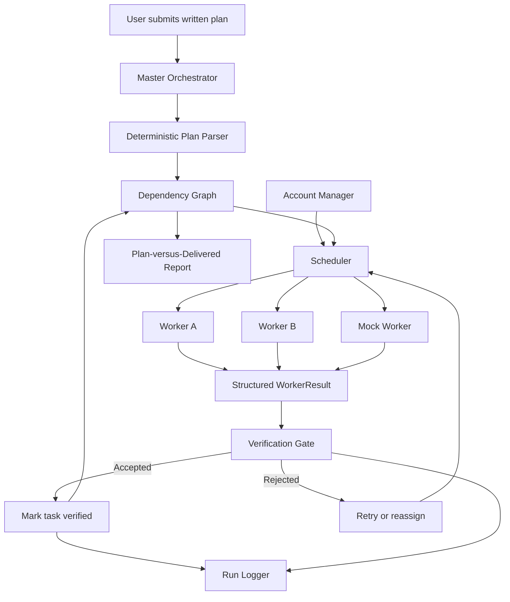

# Architecture — Multi-Account, Multi-Agent Orchestrator

## 1. Overview

The Multi-Account, Multi-Agent Orchestrator coordinates multiple AI Workers to execute a larger project plan. The Master Orchestrator manages task execution, dependencies, Worker assignment, failure handling, output verification, and delivery reporting.

The prototype converts written plan items into structured tasks using a **deterministic plan parser**. Dependencies and acceptance criteria can be supplied explicitly. The current parser does not use an LLM to infer task breakdowns or automatically discover dependencies.

The system supports mock Workers for repeatable testing and includes integrations for OpenAI and Anthropic Claude. Live-provider execution requires valid credentials, provider access, and available quota. Successful live-provider execution has not been demonstrated as part of this submission.

## 2. Architecture Diagram

## 3. Main Components

### Master Orchestrator

The Master coordinates the execution lifecycle. It accepts either pre-structured tasks or written plan text, initializes and validates the task graph, coordinates scheduling, processes Worker results, and generates execution progress and reporting data.

The Master does not treat a Worker’s completion claim as sufficient evidence of successful delivery.

### Deterministic Plan Parser

The `PlanParser` converts numbered, bulleted, or line-separated plan items into structured `Task` objects.

It supports explicitly supplied acceptance criteria and task dependencies. It validates references to unknown tasks and detects circular dependencies.

The parser performs deterministic text processing. It does not use an LLM to generate task descriptions, infer dependencies, or independently decide how a high-level goal should be decomposed.

### Dependency Graph

The dependency graph represents tasks and their prerequisites. A task becomes eligible for scheduling only when its dependencies have been completed and verified.

This prevents dependent tasks from proceeding on the basis of unverified prerequisite output.

### Scheduler

The Scheduler assigns eligible tasks to available Workers. It coordinates task execution and supports retry or reassignment behavior for failed or rejected work within configured limits.

When no suitable Worker is available or retry limits are exhausted, the task should remain unresolved rather than be represented as verified success.

### Account Manager

The Account Manager loads Worker definitions from configuration and provides the configured Worker pool to the Scheduler.

The design supports different Worker implementations behind a common interface. Mock Workers support local testing, while provider-specific Workers require their corresponding configuration, credentials, and provider access.

### Workers

Each Worker executes its assigned task and returns a structured result. Provider-specific implementations normalize their outcomes into the shared `WorkerResult` contract so the Master can process results consistently.

Workers are intended to operate within their designated workspaces. The prototype's workspace restrictions are application-level controls, not a complete operating-system security boundary.

### Verification Gate

The Verification Gate evaluates Worker results and produced artifacts against configured acceptance criteria.

The current implementation uses deterministic checks, including result status, artifact existence, workspace boundaries, non-empty output, and acceptance-criteria matching, as applicable to the configured task.

These checks do not provide a comprehensive semantic assessment of arbitrary code or documents. A passing result should be interpreted in terms of the checks actually performed, not as a guarantee of overall correctness or security.

### Run Logger

The logger records relevant orchestration events, including task assignment, Worker failures, verification outcomes, retries, and task failures.

Sensitive fields are redacted according to the implemented logging rules. Production use would require further review of secret handling, log access, retention, and audit requirements.

### Delivery Report

The delivery report compares the plan's tasks with execution results and verification outcomes. It provides visibility into completed, failed, rejected, and unresolved work.

The report should distinguish verified deliverables from tasks that could not be completed or validated.

## 4. Worker Result Contract

Workers return a shared `WorkerResult` structure containing:

- `task_id` — the task associated with the result.
- `worker_id` — the Worker that executed the task.
- `status` — the reported execution outcome.
- `files_changed` — the reported changed artifacts.
- `notes` — additional execution details.
- `error` — error information when applicable.

The common contract separates orchestration logic from provider-specific response formats. Result validation helps reject malformed data before it is accepted into the orchestration flow.

## 5. Task Lifecycle

1. The user supplies a written project plan or a list of structured tasks.
2. For written text, the deterministic parser converts each supported plan item into a structured task.
3. Explicit dependencies and acceptance criteria are associated with the generated task IDs when supplied.
4. The Master validates task IDs, dependency references, and the dependency graph.
5. The Scheduler identifies tasks whose prerequisites are verified and assigns them to available Workers.
6. A Worker executes its task and returns a structured result.
7. The Verification Gate evaluates the result and relevant artifacts.
8. Accepted tasks are marked verified, allowing dependent tasks to become eligible for execution.
9. Failed or rejected work may be retried or reassigned within configured limits.
10. Tasks that cannot be completed or verified remain unresolved and are reflected in execution progress and reporting.
11. The system produces a final report comparing planned work with delivered and verified results.

**Implementation boundary:** Written-plan parsing is implemented, but LLM-based planning and automatic inference of dependencies are not part of the current parser.

## 6. Isolation and Security

The prototype includes workspace path restrictions, checks for selected dangerous-command patterns, and sensitive-field redaction in logs.

These controls are defense-in-depth measures, not a complete operating-system sandbox. They do not guarantee protection against every malicious command, process escape, prompt injection, or indirect file and network access technique.

A production deployment would require stronger process or container isolation, restricted filesystem and network access, least-privilege permissions, managed secrets, explicit tool authorization, and additional security testing.

Credentials must be supplied through environment variables or an appropriate secret-management mechanism, never committed to source control or included in prompts and logs.

Provider integrations must comply with applicable terms, authentication requirements, rate limits, and account policies. The design does not assume that multiple subscriptions can be pooled or automated in ways that providers do not permit.

## 7. Failure Handling

The architecture accounts for Worker failures, simulated quota exhaustion, and rejected output.

- **Worker failure:** The task must not be marked verified merely because execution was attempted.
- **Quota exhaustion:** The system should use another eligible Worker when available; otherwise, the task remains unresolved.
- **Rejected output:** The Verification Gate's rejection should lead to retry or reassignment within configured limits.
- **Retry exhaustion:** The task should be reported as failed or unresolved rather than accepted.
- **Blocked dependencies:** Tasks requiring an unresolved prerequisite should not be treated as completed.

The prototype includes mock-based failure scenarios. These demonstrations do not establish that real provider quota exhaustion has been tested live.

## 8. Testing Strategy

The automated test suite covers successful orchestration and important failure paths.

The reported local test result for the current submission is **94 passed**. Tests should be rerun after code or configuration changes.

Relevant coverage includes plan parsing, task validation, dependency handling, Worker result validation, failure handling, retry or reassignment behavior, verification rejection, workspace restrictions, and sensitive-field redaction.

Passing tests demonstrate the behaviors exercised by the test suite. They do not prove production readiness, comprehensive sandbox security, or successful live-provider execution.

## 9. Current Limitations

- The plan parser is deterministic; it does not perform LLM-based task decomposition.
- Dependencies and acceptance criteria can be supplied explicitly rather than inferred automatically.
- Mock Workers support repeatable local demonstrations and failure testing.
- OpenAI and Anthropic integrations require valid credentials, provider access, and sufficient quota.
- Successful live-provider execution has not been demonstrated as part of this submission.
- Verification is primarily deterministic and does not guarantee semantic correctness.
- Workspace and command guards do not provide comprehensive operating-system sandboxing.
- Automated Git conflict resolution and a complete human-approval workflow are future improvements.
- Performance with twenty live accounts has not been benchmarked.

These limitations distinguish implemented and tested behavior from proposed production capabilities.

## 10. Design Principle

The Master coordinates execution, Workers produce artifacts, and the Verification Gate evaluates those artifacts against configured criteria.

**Completion should be based on verifiable evidence, not merely on a Worker or the Master claiming that a task succeeded.**
