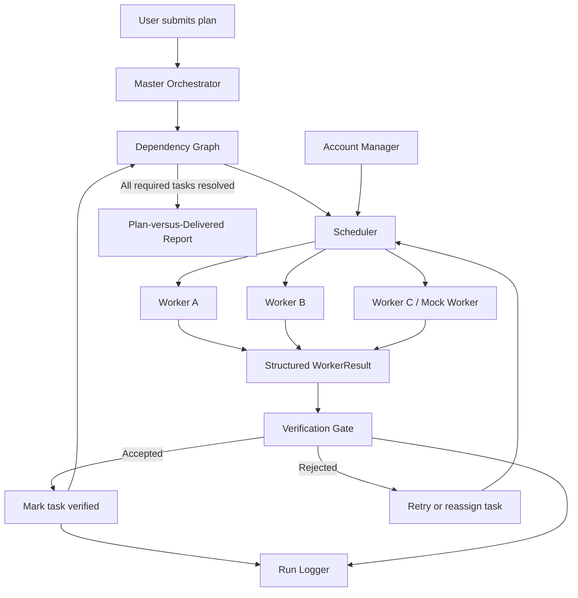

# Architecture — Multi-Account, Multi-Agent Orchestrator

## 1. Overview

The Multi-Account, Multi-Agent Orchestrator coordinates multiple AI Workers to complete a larger plan. The Master Orchestrator breaks the plan into tasks, manages dependencies, assigns tasks to available Workers, and checks their outputs before accepting them.

The prototype supports mock Workers and includes integrations for OpenAI and Anthropic Claude. Live-provider execution must be configured with valid API credentials.

## 2. Architecture Diagram

## 3. Main Components

### Master Orchestrator

The Master coordinates the execution lifecycle. It uses the scheduler and verification components rather than trusting a Worker to declare its own output successful.

Its responsibilities include task coordination, failure handling, verification decisions, and reporting.

### Dependency Graph

The dependency graph represents tasks and their prerequisites. A task becomes eligible for scheduling only when its dependencies have been completed and verified.

This prevents dependent tasks from proceeding on the basis of unverified output.

### Scheduler

The Scheduler assigns eligible tasks to available Workers. It handles retry and reassignment behavior when a Worker fails or its output is rejected.

Retries should be bounded so that a persistent failure does not cause an endless execution loop.

### Account Manager

The Account Manager loads Worker definitions from configuration and resolves provider credentials through environment variables.

The design supports different Worker types behind a common interface, allowing mock Workers and configured live-provider Workers to participate in the same orchestration flow.

### Workers

Each Worker performs its assigned task and returns a structured result. Provider-specific implementations are hidden behind a common interface so the Master does not need to process each provider's response format separately.

### Verification Gate

The Verification Gate inspects the produced artifacts against the configured acceptance criteria. A task should be marked verified only after the verification process accepts its output.

The current prototype uses deterministic checks, including artifact existence, workspace boundaries, non-empty content, and acceptance-criteria matching. This is not a full semantic assessment of arbitrary code or documents.

### Run Logger

The logger records relevant execution events, including task assignment, failures, and verification outcomes. Sensitive fields are redacted according to the implemented logging rules.

## 4. Worker Result Contract

Workers return a shared `WorkerResult` structure containing:

- `task_id` — the task being executed.
- `worker_id` — the Worker that executed it.
- `status` — the execution outcome.
- `files_changed` — the reported changed artifacts.
- `notes` — additional execution details.
- `error` — error information when applicable.

A shared contract keeps orchestration independent of provider-specific output formats.

## 5. Task Lifecycle

1. The user provides a plan.
2. The Master decomposes the plan into tasks and dependencies.
3. The dependency graph identifies tasks ready for execution.
4. The Scheduler assigns eligible tasks to available Workers.
5. A Worker executes the task in its designated workspace and returns a structured result.
6. The Verification Gate checks the result and artifacts.
7. If verification succeeds, the task is marked verified and dependent tasks can proceed.
8. If execution or verification fails, the Scheduler can retry or reassign the task within configured limits.
9. The system generates a report comparing planned work with delivered work.

## 6. Isolation and Security

The prototype includes workspace path restrictions, dangerous-command checks, and sensitive-field redaction in logs.

These controls are defense-in-depth measures, not a complete operating-system sandbox. A production deployment would need stronger process isolation, restricted filesystem and network access, least-privilege credentials, explicit tool permissions, and additional prompt-injection defenses.

Credentials must be supplied through environment variables or an appropriate secret-management mechanism, never committed to source control.

## 7. Failure Handling

The architecture accounts for Worker failures, quota-exhaustion simulations, and rejected outputs. A failed or rejected task must not be represented as verified success.

When no suitable Worker is available or retries are exhausted, the system should report unresolved work and any blocked dependencies clearly.

## 8. Current Limitations

- The mock Workers support repeatable local demonstrations and failure testing.
- OpenAI and Anthropic integrations require valid credentials and provider access.
- Live-provider execution has not been demonstrated as part of this submission.
- Verification is primarily deterministic and does not guarantee semantic correctness.
- Automated Git conflict resolution and a complete human-approval workflow are future improvements.
- Workspace and command guards do not provide comprehensive sandboxing.

## 9. Design Principle

The Master coordinates execution, Workers produce artifacts, and the Verification Gate evaluates those artifacts. Completion should be based on verifiable evidence rather than a Worker or Master simply claiming success.